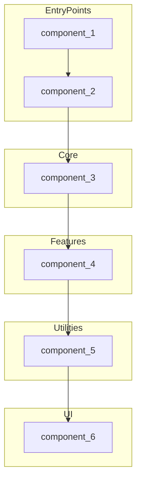

---
# Machine-readable metadata
total_components: 0
components: {
    component_1: {
        name: COMPONENT_NAME, # e.g. Button
        path: COMPONENT_PATH, # e.g. src/components/ui/button/button.tsx
        category: COMPONENT_CATEGORY, # entry_points, core, features, utilities, ui
        description: |
            COMPONENT_DESCRIPTION # e.g. Button component
        responsibilities: [
            RESPONSIBILITY_1, # e.g. Renders a button
            RESPONSIBILITY_2, # e.g. Handles button clicks
            RESPONSIBILITY_3, # e.g. Handles button hover
        ],
        dependencies: [DEPENDENCY_1, DEPENDENCY_2, DEPENDENCY_3], # e.g. react, react-dom
        used_by: [USED_BY_1, USED_BY_2, USED_BY_3], # e.g. src/pages/index.tsx, src/pages/about.tsx
        exports: [EXPORT_1, EXPORT_2, EXPORT_3] # e.g. Button
    },
    component_2: {
        name: COMPONENT_NAME, # e.g. Button
        path: COMPONENT_PATH, # e.g. src/components/ui/button/button.tsx
        category: COMPONENT_CATEGORY, # entry_points, core, features, utilities, ui
        dependencies: [DEPENDENCY_1, DEPENDENCY_2, DEPENDENCY_3], # e.g. react, react-dom
        used_by: [USED_BY_1, USED_BY_2, USED_BY_3], # e.g. src/pages/index.tsx, src/pages/about.tsx
        exports: [EXPORT_1, EXPORT_2, EXPORT_3] # e.g. Button
    }
    ...
}
complexity: {simple: 0, moderate: 0, complex: 0}
last_analyzed: ""
---

# Components & Modules

## Overview
[Overview of the components and modules]

## Component Used By Map

## Recommendations

- [Recommendation 1]
- [Recommendation 2]
- [Recommendation 3]
