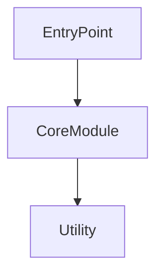

# Implementation Plan: Analyze Deep Research

## Overview
Enhance the analyze command with multi-level depth analysis (shallow/standard/deep) using a multi-file output structure. The implementation will extend the existing `commands/analyze.md` workflow to generate comprehensive project analysis including architecture, components, dependencies, relationships, and code quality metrics.

## Output Structure
- **Shallow**: `$FEATURE_DIR/analyzed/summary.md` only
- **Standard**: summary + components + architecture
- **Deep**: All 6 files (summary, components, architecture, dependencies, relationships, quality)

## Implementation Tasks

### Phase 1: Foundation & Depth Support
- [x] Update `commands/analyze.md` to accept depth parameter (shallow/standard/deep)
- [x] Add parameter parsing logic to detect `--depth` flag from user input, default to "standard"
- [x] Create directory structure `$FEATURE_DIR/analyzed/` for multi-file output

### Phase 2: Shallow Analysis (Backward Compatible)
- [x] Use existing `folder-analyzer.sh` to generate file/folder tree
- [x] Populate `analyzed/summary.md` with project statistics and overview
- [x] Extract project type, language detection, and basic structure from analyze.sh variables

### Phase 3: Standard Analysis (Components & Architecture)
- [x] Parse files to extract entry points, key functions, classes, and exports
- [x] Generate `analyzed/components.md` with component breakdown and module descriptions
- [x] Detect tech stack, frameworks, and architectural patterns for `analyzed/architecture.md`
- [x] Identify design patterns (e.g., singleton, factory) and code organization principles

### Phase 4: Deep Analysis (Dependencies & Relationships)
- [x] Implement import/export extraction for multiple languages (JS/TS, Python, Go, Bash)
- [x] Generate `analyzed/dependencies.md` with dependency graph in Mermaid format
- [x] Create `analyzed/relationships.md` mapping file dependencies and cross-component relationships
- [x] Generate `analyzed/quality.md` with code metrics (LOC, complexity, duplication, documentation coverage)

### Phase 5: Integration & Testing
- [x] Update context.md with links to all generated analysis files
- [x] Test all three depth levels on the contextual project itself
- [x] Validate performance (<5 minutes for large projects on deep mode) and accuracy

## Technical Decisions

### Language Detection & Parsing
Use grep patterns for common import/export syntax:
- **JS/TS**: `import.*from|require\(|export`
- **Python**: `^import |^from .* import`
- **Go**: `^import \(|^import "`
- **Bash**: `source |^\. `

### Dependency Graph Format
Use Mermaid diagram syntax for visual representation in markdown:

### Performance Optimization
- Use `find` with specific file extensions to limit scope
- Parallel processing for file analysis where possible
- Early exit when max depth reached
- Efficient grep patterns with `-l` flag for file listing

## Success Criteria
✓ Backward compatibility: shallow mode generates same output as current behavior  
✓ Multi-file structure: separate files for each analysis aspect  
✓ Depth control: user can specify analysis depth level  
✓ Performance: deep analysis completes in <5 minutes on 10K+ files  
✓ Accuracy: dependency relationships are correct (spot-checked)  
✓ Usefulness: AI can understand project architecture from generated analysis

## References
- Context: [specs/0009-analyze-deep-research/context.md](./context.md)
- Templates: `.contextual/templates/analyzed/`
- Current Command: `commands/analyze.md`
- Current Scripts: `.contextual/scripts/bash/analyze.sh`, `folder-analyzer.sh`

